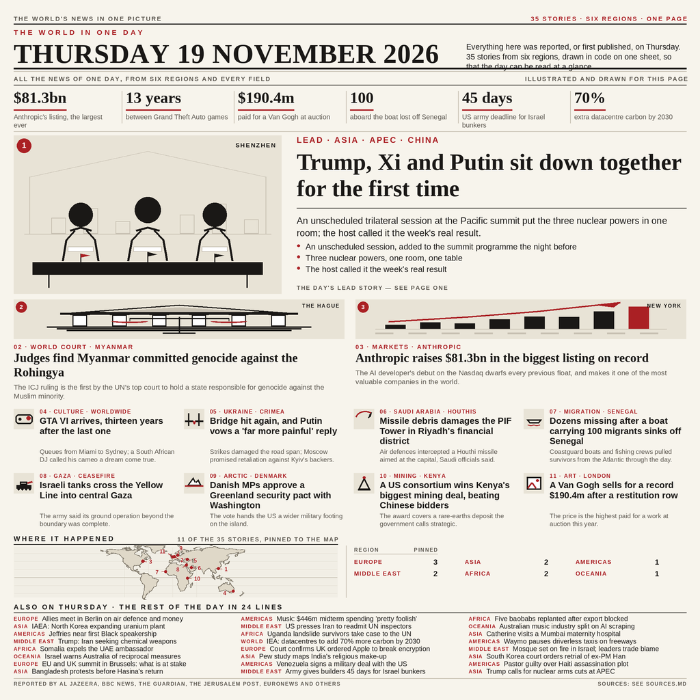

# The World in One Day — 19 November 2026

[](https://make.fun/bounty/news-image-20261119?utm_source=github&utm_medium=readme&utm_campaign=news-image-20261119)
[](https://make.fun/bounty/news-image-20261119/leaderboard?utm_source=github&utm_medium=readme&utm_campaign=news-image-20261119)
[](https://make.fun/bounty/news-image-20261119?utm_source=github&utm_medium=readme&utm_campaign=news-image-20261119)

One page, one day. Every story in this image happened, or was first published, on
**Thursday 19 November 2026**. The page holds **35 stories from six regions**: one lead
carrying the largest headline and the only full-width artwork, two more features at half
its weight, eight briefs with icons, a numbered world map, and a 24-line index along the
foot.



## What is on the page

| Band | What it carries |
|---|---|
| Masthead | The date, above a strip of six figures — one per story, none repeated |
| Lead (1) | The trilateral summit in Shenzhen, set at 34 px under 392 px of artwork |
| Features (2–3) | The ICJ's genocide ruling, Anthropic's listing |
| Briefs (4–11) | GTA VI, the Crimea bridge, a missile over Riyadh, a boat off Senegal, Gaza, Greenland, a Kenyan mining deal, Van Gogh |
| Map | Eleven numbered stories pinned where each happened, with the regional count beside it |
| Index | 24 further stories from every region, one line each |

The page is built around one decision: a reader should be able to tell, from a 300-pixel
thumbnail, that there is a lead, that there are features, and that there is a great deal
more below. So the hierarchy is strict — 34 px headline, 17.8 px features, 12.8 px
briefs, 9.8 px index — and nothing on the page is smaller than 7.4 px.

## How it is built

```
tools/render.py        draws the page (Pillow, authoring time only)
tools/content.py       the day's stories as data: kickers, headlines, decks, pins
tools/data/land.json   simplified coastlines for the map (Natural Earth, public domain)
main.py                build step: verifies entry.png and places it in the output directory
```

`main.py` is pure standard library, because the harness runs it in a bare container
with no network and a read-only mount of this repository. It parses the PNG's chunks,
checks every CRC, confirms the image is 1024×1024 RGB, walks the IDAT stream to prove
the deflate data ends exactly where the file says it does, and copies the page to
`$MAKEFUN_OUTPUT_DIR/entry.png`. Two runs produce byte-identical output:

```sh
python3 main.py          # no dependencies, no network, no timestamps
```

Every one of those checks is advisory. If any of them disagrees, the run says so and
places the artwork anyway — a graded run must not die over a warning, and the grader
does not pass stderr back to the entrant.

Redrawing the page needs Pillow, which is only ever needed at authoring time:

```sh
python3 -m venv .venv && .venv/bin/pip install pillow
RENDER_OUT=entry.png .venv/bin/python tools/render.py
```

## Layout is checked, not eyeballed

`tools/render.py` keeps a record of every text run it draws — its box, its measured
width, its size — and then audits that record before saving:

- nothing sits outside the page margins;
- no text run is wider than the cell it was given;
- no two cards overlap;
- no text escapes the cell it was assigned to.

The render also gets reviewed as a 300-pixel thumbnail, because that is the size at
which this kind of page is first judged, and the hierarchy has to survive it.

## Artwork

Every picture is drawn in code: a summit table under a hall arch, a court facade with
its portico and scales, a listing chart, eight small icons, and the world map. The map
is an equirectangular projection of the Natural Earth land layer, and its pins are
placed from real coordinates so the crowded European cluster stays readable. No
photographs, stock images or third-party illustrations appear anywhere on the page.

## Sources

`SOURCES.md` lists all 35 stories with the outlet, the headline as published, and a
link to the item.

## Licence

MIT.

## The bounty

This page is an entry in make.fun's ["Sum up 19 November's world news in one image"](https://make.fun/bounty/news-image-20261119) bounty.
